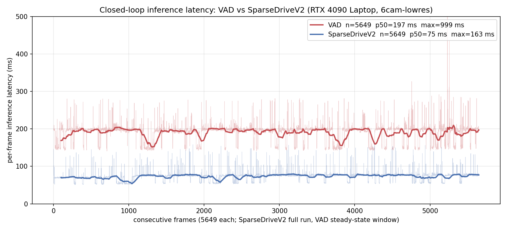

# apollo-e2e-closedloop

Drive a CARLA-simulated vehicle with an end-to-end planning model inside Apollo, closed-loop: the model sees the CARLA surround-view cameras, publishes its plan as ADCTrajectory on /apollo/planning, and the Apollo control module steers the CARLA ego from that plan.

The project demonstrates the integration of TensorRT-quantized end-to-end driving models into the Apollo CyberRT stack, with a model-agnostic relay so the model runs outside the Apollo container (host TensorRT 10.x) while everything Apollo-side stays stock except a small control overlay. Two models are integrated and validated closed-loop: VAD and SparseDriveV2. The relay, bridge, control overlay, and bring-up stages are model-agnostic - a new model adds a host-side service plus engine pointers ([docs/model_contract.md](docs/model_contract.md) is the insertion contract).

## Results

Measured on the validation host (RTX 4090 Laptop GPU, 32G RAM), CAM_PROFILE=6cam-lowres, engines backbone_int8 + head_withprev_fp16_fixed_v2 (see [ckpts/README.md](ckpts/README.md)):

| metric | value | source |
|---|---|---|
| gate 1 (waypoint sanity, 30 s) | PASS - 195 frames, plan extent <= 2.82 m, infer p50 130 ms | run/gate1.json |
| gate 2 (closed loop, 300 s window) | PASS - net displacement 8.6 m, max speed 3.1 m/s, 0 watchdog restarts | run/gate2.json |
| gate 3 (latency, n=18061) | p50 191.7 ms, p90 228.1 ms, p99 376 ms, plan rate 5.2 Hz; GPU SM util 34.9% | run/latency_summary.json |

Earlier GPU-server (RTX A6000) closed-loop reference: ~130 m driven at sustained 0.33-0.66 m/s under real throttle, production 6cam 800x600 profile.

### SparseDriveV2 on the same host, same loop, same windows

Measured in the same session, CAM_PROFILE=6cam-lowres, 4-engine fp16 cascade (backbone + head + map + motion_plan, see [ckpts/README.md](ckpts/README.md)). GATE1_WINDOW=60 (the four-engine load takes about a minute):

| metric | value | source |
|---|---|---|
| gate 1 (waypoint sanity, 60 s) | PASS - 802 frames, plan extent <= 3.05 m, infer p50 70 ms | run/gate1.json |
| gate 2 (closed loop, 300 s window) | PASS - net displacement 7.3 m, max speed 4.2 m/s, 0 watchdog restarts | run/gate2.json |
| gate 3 (latency, n=5649) | p50 74.9 ms, p90 78.1 ms, p99 130 ms, plan rate 13.35 Hz; GPU SM util 34.1% | run/latency_summary.json |

Per-frame inference latency over 5649 consecutive service frames per model (the shorter run's full length): SparseDriveV2 holds a tight ~75 ms band while VAD sits near 200 ms with CARLA-contention spikes. Light curve = raw per-frame values, solid = 100-frame rolling mean; the VAD max (999 ms) is clipped at the 500 ms axis:



## Architecture in one screen

```
CARLA 0.9.15 -> bridge (Apollo dev container) -> relay (CyberRT <-> TCP msgpack)
                                                     | 127.0.0.1:9101
             host model service (vad / sparsedrive, TRT engines) <-
             ADCTrajectory -> /apollo/planning -> refined MPC -> ControlCommand -> CARLA ego
```

Full data path, design rationale, and the per-component log table: [docs/architecture.md](docs/architecture.md).

## Quick start

1. Get the prerequisites: CARLA 0.9.15, the Apollo v8 dev docker image, an Apollo v8.0.0 source tree, and the VAD TensorRT engines + plugin (download table in [ckpts/README.md](ckpts/README.md)).
2. Fill [scripts/env.sh](scripts/env.sh) inputs via environment variables (CARLA_ROOT, APOLLO_SRC, VAD_ENGINES_DIR, VAD_PLUGIN, conda env names); [scripts/check_env.sh](scripts/check_env.sh) verifies every row and prints fix pointers on miss.
3. Bring the whole loop up in numbered stages with per-stage logs and fail-fast: [scripts/run_bringup.sh](scripts/run_bringup.sh) (flags --from-stage/--to-stage; RUN_SKIP_BUILD=1 skips the long control build on rerun; MODEL=sparsedrive swaps in the SparseDriveV2 service and gate band, [models/sparsedrive/README.md](models/sparsedrive/README.md)).
4. Watch gate 1/2/3 verdicts land in run/gate1.json, run/gate2.json, run/latency_summary.json.

Stage table, gate definitions, and per-stage troubleshooting: [docs/bring_up.md](docs/bring_up.md) and [docs/validation.md](docs/validation.md).

## Hardware honesty

The laptop run shares one 32G RAM pool and one GPU across CARLA rendering, Apollo control, and TRT inference. It works with the defaults (6cam-lowres, serial gates, watchdog budget) but is not headroom-rich; on a 32G host keep other GPU/RAM consumers idle during a run. Gate 2's watchdog budget exists precisely because CARLA RenderOffScreen can stall periodically on this class of host - see [docs/known_issues.md](docs/known_issues.md).

## Acknowledgements

- [guardstrikelab/carla_apollo_bridge](https://github.com/guardstrikelab/carla_apollo_bridge) - the CARLA-Apollo bridge this project patches (see NOTICE for the full attribution list)
- [Apollo](https://github.com/ApolloAuto/apollo) (Apache-2.0) and [CARLA 0.9.15](https://github.com/carla-simulator/carla/tree/0.9.15) (MIT) - the two stacks being integrated
- [hustvl/VAD](https://github.com/hustvl/VAD) - the VAD model; engines are built from it by hous-lab/vad-trt-edge
- [SparseDriveV2](https://github.com/swc-17/SparseDriveV2/tree/bench2drive) - the second model on this toolchain; engines are built from it by hous-lab/sparsedrive-trt-edge ([models/sparsedrive/README.md](models/sparsedrive/README.md))

License: Apache-2.0 (see LICENSE and NOTICE).
